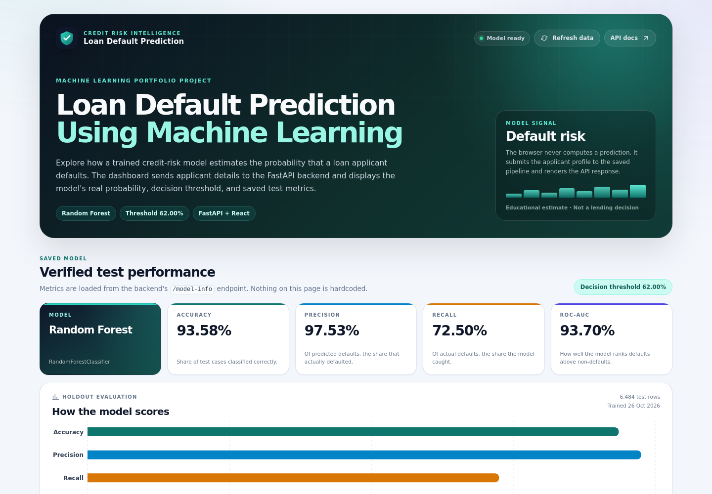
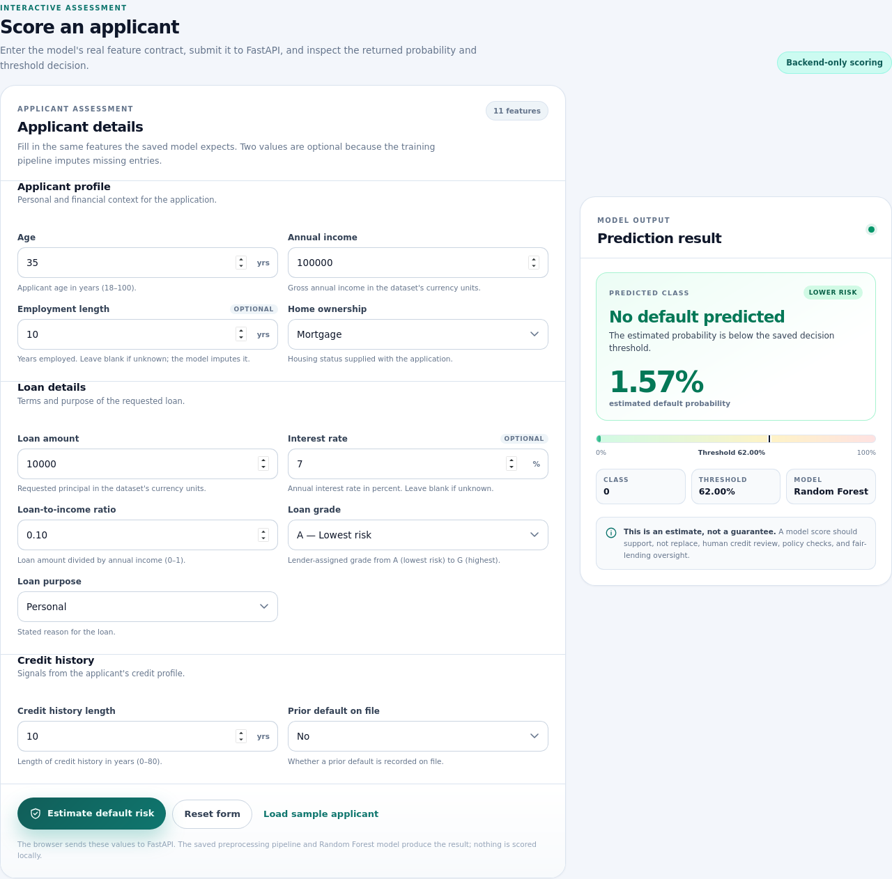
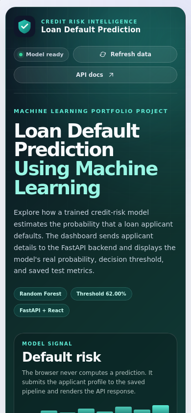

# Loan Default Prediction Using Machine Learning

An end-to-end credit-risk project that explores a public loan dataset, trains a
leakage-safe scikit-learn pipeline, serves the saved model through FastAPI, and
displays real predictions in a responsive React + Vite dashboard.

The application is deliberately split into three layers:

1. A reproducible offline training pipeline.
2. A reusable Python inference service with artifact/contract validation.
3. A browser UI that calls the backend and never calculates a prediction itself.

> **Educational project only.** This is not a lending decision, a credit score,
> financial advice, or a guarantee that an applicant will or will not default.

## Screenshots

These are actual screenshots captured from a local run on **2026-10-27** using
the saved model — not mockups. The prediction screenshot shows the sample
applicant returning a **1.57%** estimated default probability (`no default`) at
the saved **0.62** threshold.

| Desktop dashboard | Prediction result |
| --- | --- |
|  |  |

The responsive mobile layout:



The screenshots live in [`docs/screenshots/`](docs/screenshots/). To recapture
them, start both services, open the dashboard, and use your browser or
Playwright's screenshot command.

## Features

- Data audit, cleaning, and exploratory analysis with saved figures and findings
- Leakage-safe preprocessing fitted only on the training split
- Comparison of Logistic Regression, Decision Tree, and Random Forest, with and
  without balanced class weights
- 5-fold cross-validated tuning, decision-threshold selection, and one final
  test evaluation
- Saved preprocessing + model pipeline and machine-readable metadata
- Reusable inference service with feature-contract, category, range, and
  target-leakage checks
- FastAPI endpoints for health, model information, and prediction
- Responsive React dashboard with real saved-model metrics, validation, loading,
  error, and prediction states
- Python and frontend tests, plus descriptions and limitations in the repository
- No browser-side model inference or hardcoded evaluation metrics

## Architecture and request flow

```text
Browser
  React 19 + Vite dashboard
        |
        | GET /health, GET /model-info, POST /predict (JSON)
        v
FastAPI application (app/main.py)
  |-- Pydantic request/response validation (app/schemas.py)
  |-- PredictionService (src/predict.py)
  |     |-- checks feature names, ranges, categories, and metadata
  |     `-- calls pipeline.predict_proba(...)
  v
Saved model artifact (models/loan_default_pipeline.joblib)
  |-- ColumnTransformer preprocessing
  `-- RandomForestClassifier
        |
        `--> probability + threshold decision
                |
                v
        JSON response to the browser
```

Request flow:

1. At startup, FastAPI's lifespan handler loads the joblib pipeline and metadata
   once into application state. Loading is cached for the life of the process.
2. The dashboard calls `GET /health` and `GET /model-info` in parallel.
3. A user fills the 11-feature applicant form. The browser performs friendly
   validation, then sends JSON to `POST /predict`.
4. FastAPI/Pydantic validates the request shape and numeric bounds. The
   prediction service performs the final fitted-contract and category checks.
5. The saved preprocessing pipeline transforms the applicant row, and the Random
   Forest returns the probability of class `1` (default).
6. The service compares that probability with the saved threshold of `0.62`.
   `probability >= threshold` means `default`; otherwise it means `no default`.
7. The backend returns the probability, class, threshold, and model name. React
   renders those values directly. The browser never recomputes the decision.

## Technologies

| Area | Tools used |
| --- | --- |
| Language and data | Python 3.13.5, pandas 3.1.0, NumPy 2.5.4 |
| Machine learning | scikit-learn 1.9.1, joblib 1.6.0 |
| Visualization | Matplotlib, seaborn, Jupyter |
| Backend | FastAPI 0.162.0, Pydantic 2.14.1, Uvicorn 0.54.0 |
| Frontend | React 19.3.1, Vite 8.3.5, JavaScript, hand-written CSS, Recharts 3.10.1 |
| Testing | pytest, FastAPI `TestClient`, Vitest 5.0.5, Testing Library |

## Dataset

- **Source:** [Kaggle — Credit Risk Dataset](https://www.kaggle.com/datasets/laotse/credit-risk-dataset)
- **Uploader:** `laotse`
- **License:** **CC0: Public Domain**
- **File:** [`data/credit_risk_dataset.csv`](data/credit_risk_dataset.csv)
- **Size:** 32,581 rows × 12 columns
- **Target:** `loan_status` — `1` = default, `0` = no default
- **Default rate:** approximately 21.9% before the split
- **Dataset notes:** [`data/README.md`](data/README.md)
- **Download helper:** `python data/download_data.py` (verifies the SHA-256)

Cleaning is intentionally conservative:

- 165 exact duplicate rows were removed, leaving **32,416** rows.
- Ages above 100, employment lengths above 60 years, and employment longer than
  age were replaced with `NaN`, not deleted.
- Missing numeric values are imputed by the fitted pipeline using training data
  only. `person_emp_length` (895 missing) and `loan_int_rate` (3,116 missing)
  are optional in the API because the pipeline learned imputers for them.
- Genuine high-income/high-loan outliers were retained; the model's `log1p`
  transform and robust tree-based splits reduce their influence.
- A stratified 80/20 split produced **25,932 training** and **6,484 test**
  rows, with approximately the same default rate in both sets.

The dataset is simulated/synthetic credit-bureau data published for learning and
portfolio work. It is not real customer data. `loan_grade` and `loan_int_rate`
are lender-assigned fields, so the model can partly learn existing lending
judgements rather than an independent causal signal.

## Model and evaluation

A stratified 5-fold cross-validation on the training split compared six baseline
variants (three algorithms, each with and without `class_weight="balanced"`),
then tuned each family. The selection rule was **highest mean CV ROC-AUC**, with
mean CV F1 as the tie-breaker. The test set was used once, after all model and
threshold choices were frozen.

**Selected model:** Random Forest with `class_weight="balanced"`,
`max_depth=20`, `min_samples_leaf=1`, `max_features=0.5`, and 200 trees.

**Decision threshold:** **0.62**, selected by maximizing F1 on out-of-fold
training predictions.

| Test metric | Value |
| --- | ---: |
| Accuracy | **93.58%** |
| Precision | **97.53%** |
| Recall | **72.50%** |
| F1-score | **83.17%** |
| ROC-AUC | **93.70%** |
| PR-AUC | **89.19%** |
| Decision threshold | **0.62** |
| Test rows | **6,484** |

Confusion matrix at the selected threshold:

| Actual \ Predicted | No default | Default |
| --- | ---: | ---: |
| Actual no default | 5,040 (TN) | 26 (FP) |
| Actual default | 390 (FN) | 1,028 (TP) |

The model caught 1,028 of 1,418 actual defaults and missed 390. It also flagged 26
of 5,066 good loans as risky. At the default 0.50 cutoff, the test metrics would
be 93.14% accuracy, 92.64% precision, 74.54% recall, and 82.61% F1; moving to
0.62 trades a little recall for higher precision.

### Why threshold tuning matters

The default 0.50 cutoff is arbitrary. This project uses out-of-fold training
probabilities — each training row is scored only by a model that did not see it
during that fold — to choose the F1-maximizing threshold. The test set is not
used for threshold selection. At 0.62, the out-of-fold training precision, recall,
and F1 were 97.22%, 72.19%, and 82.86% respectively.

A real lender might choose a lower threshold if missing a default is more costly
than a false alarm, or a higher threshold if manually reviewing good applicants is
expensive. The API returns the probability as well as the class decision so this
remains a policy choice rather than a property of the model.

### Feature contract

The saved pipeline expects these 11 features in this order:

| Feature | Required | Values / notes |
| --- | --- | --- |
| `person_age` | yes | 18–100 years |
| `person_income` | yes | 1,000–10,000,000 currency units; log-transformed |
| `person_emp_length` | optional | 0–60 years; median-imputed when missing |
| `loan_amnt` | yes | 100–1,000,000 currency units; log-transformed |
| `loan_int_rate` | optional | 0–100 percent; median-imputed when missing |
| `loan_percent_income` | yes | 0–1 fraction of income |
| `cb_person_cred_hist_length` | yes | 0–80 years |
| `loan_grade` | yes | `A`–`G` (ordinal) |
| `person_home_ownership` | yes | `MORTGAGE`, `OTHER`, `OWN`, `RENT` |
| `loan_intent` | yes | `DEBTCONSOLIDATION`, `EDUCATION`, `HOMEIMPROVEMENT`, `MEDICAL`, `PERSONAL`, `VENTURE` |
| `cb_person_default_on_file` | yes | `N` or `Y` |

`loan_status` is the target and is explicitly rejected as an input. The numeric
bounds above are application sanity checks, not training-derived statistics.

### Top model features

The largest impurity-based importances are:

1. `loan_percent_income` (0.2187)
2. `person_income` after log transform (0.1683)
3. `loan_grade` (0.1572)
4. `loan_int_rate` (0.1060)
5. `loan_amnt` after log transform (0.0590)

These values describe what the forest uses, not what causes default. Correlated
features share importance, and impurity importance can favor continuous or
high-cardinality features.

The complete comparison, tuning table, threshold analysis, and limitations are
in [`reports/model_report.md`](reports/model_report.md).

## Project structure

```text
loan-default-prediction/
├── app/
│   ├── main.py                 # FastAPI app, lifespan, endpoints, CORS, errors
│   ├── schemas.py              # Pydantic request/response models
│   └── README.md               # backend documentation
├── data/
│   ├── credit_risk_dataset.csv # committed dataset (CC0)
│   ├── download_data.py        # checksum-verifying download helper
│   └── README.md
├── docs/
│   └── screenshots/            # actual dashboard screenshots
├── frontend/
│   ├── src/                    # React components, API client, validation
│   ├── package.json
│   ├── vite.config.js          # dev port 5173, preview port 4173
│   └── README.md
├── models/
│   ├── loan_default_pipeline.joblib
│   └── model_metadata.json
├── notebooks/
│   └── loan_default_analysis.ipynb
├── reports/
│   ├── eda_findings.md
│   ├── eda_summary.json
│   ├── model_metrics.json
│   ├── model_report.md
│   └── figures/
├── src/
│   ├── preprocessing.py        # cleaning, split, pipeline construction
│   ├── predict.py              # reusable inference service
│   ├── evaluation.py           # metrics, threshold, plots
│   └── eda.py                  # EDA report and figures
├── tests/                      # pytest suite
├── train.py                    # reproducible training entry point
├── requirements.txt
└── INTERVIEW_PREPARATION.md
```

## Installation on Debian Linux

### Prerequisites

- Debian/Linux (the tested environment is Debian)
- Python 3.13 and `venv` (tested with Python 3.13.5)
- Node.js 20.19 or newer and npm (Node 24 / npm 11 tested)
- No Kaggle account is needed for the committed dataset; the optional download
  helper uses the public Kaggle download endpoint

Check the tools:

```bash
cd ~/loan-default-prediction
python3 --version
node --version
npm --version
```

If `python3-venv` is missing on Debian, install it with your normal package
manager. For example:

```bash
sudo apt update
sudo apt install -y python3-venv
```

### Python environment

```bash
cd ~/loan-default-prediction
python3 -m venv .venv
. .venv/bin/activate
python -m pip install --upgrade pip
python -m pip install -r requirements.txt
```

The `.venv/` directory is ignored by Git.

### Dataset

The CSV is already in `data/credit_risk_dataset.csv`. To verify or refresh it:

```bash
.venv/bin/python data/download_data.py
```

The helper checks the expected SHA-256 and will not silently accept a changed
file. If it cannot reach Kaggle, download the dataset manually from the Kaggle
page and place `credit_risk_dataset.csv` in `data/`.

### Frontend dependencies

```bash
cd ~/loan-default-prediction/frontend
npm install
cp .env.example .env.local
```

`frontend/.env.local` is ignored. The example file contains the default API URL:

```dotenv
VITE_API_BASE_URL=http://127.0.0.1:8000
```

## Run the application

Use two terminals.

**Terminal 1 — FastAPI:**

```bash
cd ~/loan-default-prediction
.venv/bin/uvicorn app.main:app --reload --host 127.0.0.1 --port 8000
```

**Terminal 2 — React/Vite:**

```bash
cd ~/loan-default-prediction/frontend
npm run dev
```

Open:

- Dashboard: <http://127.0.0.1:5173>
- API docs: <http://127.0.0.1:8000/docs>
- Alternative docs: <http://127.0.0.1:8000/redoc>
- OpenAPI JSON: <http://127.0.0.1:8000/openapi.json>

The dashboard calls `/health` and `/model-info` on load. If the API is
unreachable or the model is not ready, it hides the metrics and disables
submission instead of showing a locally calculated answer.

### Ports and CORS

The supported defaults are backend `8000` and frontend `5173`. The backend CORS
allow-list contains exactly:

```text
http://localhost:5173
http://127.0.0.1:5173
```

The Vite dev server uses `strictPort: true`, so it exits rather than silently
moving to another port and breaking CORS.

If a default port is occupied:

1. Choose another backend port, for example `8765`, without stopping unrelated
   services.
2. Set `VITE_API_BASE_URL` in `frontend/.env.local` to that exact API URL.
3. If the frontend also moves, add the new exact browser origin to
   `CORS_ORIGINS` in `app/main.py` and restart FastAPI.

Example backend command:

```bash
cd ~/loan-default-prediction
.venv/bin/uvicorn app.main:app --reload --host 127.0.0.1 --port 8765
```

Example `frontend/.env.local`:

```dotenv
VITE_API_BASE_URL=http://127.0.0.1:8765
```

Temporary ports used during verification are not permanent defaults and should
not be added to the committed CORS list unless you intentionally support them.
`npm run preview` uses port `4173` and is not in the default CORS allow-list.

## Train the model (optional)

The app loads the committed artifacts. Retraining is **not** required to run or
test the dashboard. To reproduce the artifacts from scratch:

```bash
cd ~/loan-default-prediction
.venv/bin/python train.py
```

The script:

1. Loads and cleans the CSV, removes duplicate rows, and creates a stratified
   80/20 split.
2. Compares Logistic Regression, Decision Tree, and Random Forest with and
   without balanced class weights using 5-fold cross-validation on the training
   split.
3. Tunes each family with cross-validation on the training split.
4. Selects the best mean CV ROC-AUC (CV F1 tie-breaker), computes out-of-fold
   probabilities, and selects the F1-maximizing threshold.
5. Refits on all training rows, evaluates once on the untouched test set, and
   writes:
   - `models/loan_default_pipeline.joblib`
   - `models/model_metadata.json`
   - `reports/model_metrics.json`
   - `reports/model_report.md`
   - the figures in `reports/figures/`

The full run retrains a 200-tree forest and performs several searches, so it is
intentionally heavier than starting the API. Do not retrain unless you intend to
replace the artifacts.

## Tests and production build

Python tests:

```bash
cd ~/loan-default-prediction
.venv/bin/python -m pytest -q
```

Frontend tests and build:

```bash
cd ~/loan-default-prediction/frontend
npm run test:run
npm run build
```

Latest verified checkpoint:

- Python: **63 passed**
- Frontend: **4 test files, 30 tests passed**
- Production build: **passed**
- Build output: main JS **253.94 kB** (79.18 kB gzip), lazy chart chunk
  **357.42 kB** (103.56 kB gzip), CSS **24.62 kB**

The generated `frontend/dist/` directory is ignored and can be regenerated at
any time.

## API reference

| Method | Endpoint | Purpose |
| --- | --- | --- |
| `GET` | `/health` | API status and whether the model loaded |
| `GET` | `/model-info` | Model name, threshold, feature list, and saved test metrics |
| `POST` | `/predict` | Score one applicant and return probability + class |
| `GET` | `/docs` | Swagger UI (interactive OpenAPI documentation) |
| `GET` | `/redoc` | ReDoc documentation |
| `GET` | `/openapi.json` | Raw OpenAPI schema |

### `GET /health`

```bash
curl http://127.0.0.1:8000/health
```

Actual ready response:

```json
{
  "api": "ok",
  "status": "ok",
  "model_ready": true,
  "model_name": "Random Forest",
  "detail": null
}
```

If the artifacts cannot be loaded, the endpoint returns HTTP `503` with
`status: "degraded"` and `model_ready: false`.

### `GET /model-info`

```bash
curl http://127.0.0.1:8000/model-info
```

The response is read from `models/model_metadata.json`, not recomputed from the
test set. Its top-level fields are:

```json
{
  "model_name": "Random Forest",
  "model_key": "random_forest",
  "estimator_class": "RandomForestClassifier",
  "threshold": 0.62,
  "trained_at": "2026-10-26T17:44:33+00:00",
  "metrics": {
    "threshold": 0.62,
    "accuracy": 0.9358420727945712,
    "precision": 0.9753320683111955,
    "recall": 0.7249647390691114,
    "f1": 0.8317152103559871,
    "roc_auc": 0.9370281257778146,
    "pr_auc": 0.891919702648949
  },
  "features": ["..."],
  "target": {
    "name": "loan_status",
    "positive_label": 1,
    "negative_label": 0,
    "positive_meaning": "default",
    "negative_meaning": "no default"
  }
}
```

The full response also includes the confusion matrix and support counts.

### `POST /predict`

Request — the low-risk sample used by the dashboard and tests:

```bash
curl -X POST http://127.0.0.1:8000/predict \
  -H 'Content-Type: application/json' \
  -d '{
    "person_age": 35,
    "person_income": 100000,
    "person_emp_length": 10.0,
    "loan_amnt": 10000,
    "loan_int_rate": 7.0,
    "loan_percent_income": 0.10,
    "cb_person_cred_hist_length": 10,
    "loan_grade": "A",
    "person_home_ownership": "MORTGAGE",
    "loan_intent": "PERSONAL",
    "cb_person_default_on_file": "N"
  }'
```

Actual response from the saved model:

```json
{
  "predicted_class": 0,
  "predicted_label": "no default",
  "default_probability": 0.0156875,
  "threshold": 0.62,
  "model_name": "Random Forest"
}
```

The API's high-risk test fixture (age 23, income 30,000, grade F, prior default
`Y`) returns `predicted_class: 1`, `predicted_label: "default"`, and
`default_probability: 1.0` with the same saved model.

`predicted_class` is `1` when `default_probability >= threshold`; otherwise it is
`0`. The probability is a model estimate, not a guarantee.

### Validation and error responses

| Status | Meaning |
| --- | --- |
| `200` | Request succeeded |
| `422` | Invalid applicant data or request shape |
| `500` | Unexpected inference or server failure |
| `503` | Model artifacts are unavailable |

Examples of rejected input:

- Missing required fields
- Invalid numeric types, booleans used as numbers, NaN/Infinity, or values out of
  range
- Employment longer than age
- Unknown category values such as `loan_grade: "Z"`
- Extra fields (Pydantic `extra="forbid"`)
- `loan_status` supplied as an input

Pydantic validation failures return `422` with a short `detail` plus field-level
`errors`; service-level contract failures return `422` with a safe `detail`.
Error responses never include Python tracebacks or local filesystem paths.

## Troubleshooting

### `Address already in use` / a port is occupied

Do not terminate unrelated services. Check what is listening:

```bash
ss -ltnp | grep -E ':(8000|5173)'
```

Start FastAPI on another port and update `VITE_API_BASE_URL` as described in
[Ports and CORS](#ports-and-cors). If the Vite port changes too, add its exact
origin to `CORS_ORIGINS` and restart the backend.

### The UI says “API offline”

The browser could not reach `/health`. Confirm FastAPI is running:

```bash
curl http://127.0.0.1:8000/health
```

Then click **Refresh data** in the dashboard. Check the browser Network panel for
the failed request and confirm `VITE_API_BASE_URL` points at the API's actual
scheme, host, and port.

### Browser console shows a CORS error

The frontend origin must exactly match an entry in `CORS_ORIGINS` in
`app/main.py`. `http://localhost:5174` and `http://127.0.0.1:5174` are not
allowed by default. Add only the origin you are intentionally using and restart
FastAPI.

### The UI says “Model unavailable” or `/health` returns `503`

The API is running, but the model artifacts could not be loaded. Check:

```bash
ls -lh models/loan_default_pipeline.joblib models/model_metadata.json
.venv/bin/python -m pytest tests/test_predict.py -q
```

Common causes are missing files, a corrupt/partial artifact, a changed metadata
feature order, or an incompatible Python/joblib environment. Retrain only if you
intend to replace the artifacts:

```bash
.venv/bin/python train.py
```

### `422` on a valid-looking applicant

Compare the field names and category spelling with the
[feature contract](#feature-contract). Category values are normalized to
uppercase, but unsupported values are rejected. `person_emp_length` and
`loan_int_rate` may be omitted or blank, not filled with arbitrary text.

### Frontend build fails

Use Node.js 20.19 or newer, then reinstall:

```bash
cd ~/loan-default-prediction/frontend
rm -rf node_modules
npm install
npm run build
```

The build writes `frontend/dist/`, which is ignored by Git.

### A previous prediction remains visible after the backend becomes unavailable

This is a known UI limitation. A prediction already stored in React state is
still rendered if the backend later goes offline; the result is the last real
backend response, not a new prediction. Treat it as stale and do not rely on it.
A proposed safe fix is to clear the stored prediction when the user refreshes or
when the health check transitions to not-ready. The fix is documented here but
was deliberately not applied without review because it changes frontend source
code.

## Responsible use and limitations

This project is an educational model, not a production credit decision system.

- **Synthetic data:** results do not transfer automatically to a real loan book.
- **No fairness audit:** age, income, home ownership, and other fields can
  correlate with protected characteristics. A real system needs subgroup
  performance testing and fair-lending review.
- **No temporal validation:** a real deployment needs later-vintage loans and
  drift monitoring.
- **Lender-assigned fields:** `loan_grade` and `loan_int_rate` may already encode
  a lender's judgment, so the model partly learns existing policy.
- **Probabilities are model scores:** no calibration guarantee; a calibration
  plot in the report is a sanity check, not a guarantee.
- **No authentication, rate limiting, or privacy controls:** the API is intended
  for local development.
- **Pickle/joblib trust:** only load model artifacts from a trusted source.
- **Stale UI result:** see the known limitation above; the last result can remain
  on screen after the API becomes unavailable.
- **Not for real lending:** do not use this score for credit eligibility,
  pricing, or adverse-action decisions.

The report's full limitations section is in
[`reports/model_report.md`](reports/model_report.md).

## Documentation map

- [`INTERVIEW_PREPARATION.md`](INTERVIEW_PREPARATION.md) — project walkthrough,
  technical explanations, and interview questions with answers
- [`app/README.md`](app/README.md) — backend endpoints, lifecycle, and API tests
- [`frontend/README.md`](frontend/README.md) — dashboard setup, design notes, and
  frontend tests
- [`data/README.md`](data/README.md) — dataset columns, license, and download
- [`reports/model_report.md`](reports/model_report.md) — full model comparison,
  tuning, threshold selection, and test evaluation
- [`reports/eda_findings.md`](reports/eda_findings.md) — data-quality and EDA
  findings

## License

The dataset is released under **CC0: Public Domain**; see
[`data/README.md`](data/README.md). This repository does not currently include a
separate code license file. If you plan to publish or reuse the code, add the
license you intend to use (for example, MIT) before relying on those terms.
